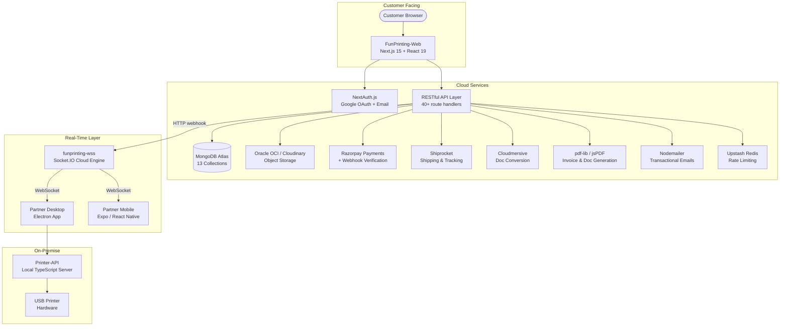

# 🖨️ Fun Printing — Distributed Printing Orchestration Platform


**Fun Printing** is a production-grade, multi-service printing orchestration platform built for franchise-model campus printing. It connects customers, franchise partners (shopkeepers), and physical printers through a real-time event-driven architecture spanning **five independent services**, a **WebSocket relay**, and native partner applications for Windows and Android.

**Live:** [funprinting.store](https://www.funprinting.store/)

---

## 🏗️ System Architecture

The platform is decomposed into five cooperating services that communicate via REST, WebSockets, and webhook callbacks.



### Key Architectural Decisions
- **Microservice Decomposition**: Each concern (web, payments, real-time dispatch, hardware printing, mobile management) runs as an independent deployable unit.
- **WebSocket Relay Pattern**: The cloud WSS broker decouples the web app from partner hardware. Partners connect via JWT-authenticated Socket.IO; print jobs are dispatched to partner-specific rooms.
- **Dual Storage Provider**: Pluggable storage layer supporting Oracle OCI (free tier, no file size limits) and Cloudinary, switchable via environment variable.
- **Franchise Partner Model**: Partners are shopkeepers with geo-indexed locations, delivery points, supported printers, individual pricing, and revenue splits via Razorpay Route.

---

## 📦 Monorepo Structure

```
Fun Printing/
├── FunPrinting-Web/          # Next.js 15 web app (customer + admin + partner portal)
│   ├── src/
│   │   ├── app/              # 30+ App Router pages & 40+ API route handlers
│   │   ├── components/       # 25+ reusable React components
│   │   ├── lib/              # 38 core utility modules (payments, storage, email, etc.)
│   │   ├── models/           # 13 Mongoose schemas (see Database section)
│   │   └── hooks/            # Custom React hooks
│   ├── public/               # Static assets
│   ├── scripts/              # Setup & test scripts
│   ├── Dockerfile            # Multi-stage production build
│   └── .github/workflows/    # CI/CD pipelines
│
├── funprinting-wss/          # WebSocket relay server (Socket.IO + Express)
│   └── index.js              # JWT-auth, partner rooms, print job dispatch
│
├── Printer-API/              # Local printer server (TypeScript + Express)
│   └── src/                  # USB printer integration, delivery numbers, queue
│
├── partner-desktop/          # Electron desktop app for Windows/macOS
│   ├── main.js               # Electron main process
│   └── src/                  # UI, printer utils, queue management
│       ├── ui/               # Auth, settings, order screens
│       ├── printer/          # Hardware printer integration
│       └── queue/            # Persistent print queue store
│
└── partner-mobile/           # Expo/React Native mobile app for Android
    └── App.js                # Full partner management app
```

---

## 🗄️ Database Schema (MongoDB Atlas — 13 Collections)

| Collection | Purpose | Key Fields |
|---|---|---|
| **User** | Customer & partner accounts | `email`, `provider` (email/google), `role` (customer/partner/admin), `upiId`, `bankDetails`, `favoriteTemplateIds` |
| **Order** | Full order lifecycle | `orderId`, `orderType` (file/template), `fileURLs[]`, `printingOptions` (per-file options, mixed color), `deliveryOption` (pickup/delivery with geo), `status` (10 states), `shiprocket` tracking, `verificationOtp`, `partnerId` |
| **Partner** | Franchise partner profiles | `location` (2dsphere GeoJSON), `deliveryPoints[]`, `supportedPrinters[]`, `earnings`, `servicesOffered`, `pricing`, `razorpayAccountId` |
| **Printer** | Physical printer registry | `connectionType` (usb/network/wireless), `capabilities`, `status`, `totalPagesPrinted`, `autoPrintEnabled` |
| **PrintJob** | Individual print job tracking | `printingOptions`, `status`, `priority`, `retryCount`, `printerId`, `estimatedDuration` |
| **DynamicTemplate** | Template marketplace | `wordUrl`, `placeholders[]`, `formSchema[]`, `category`, `isPaid`, `price`, `creatorPayoutMethod`, `createdByUserId` |
| **CreatorEarning** | Template monetization ledger | `creatorUserId`, `amount`, `platformShareAmount`, `status` (pending/processing/paid/failed), `payoutMethod` |
| **Pricing** | Global pricing configuration | `basePrices` (A4/A3), `multipliers` (color/duplex), `deliveryCharges` (distance tiers), `templateCommissionPercent` |
| **PickupLocation** | Physical pickup points | `lat/lng`, `contactPerson`, `operatingHours`, `gmapLink`, `isDefault` |
| **Admin** | Admin credentials | `email`, `password`, `role` (admin/super-admin) |
| **AdminInfo** | Business/SEO configuration | `businessHours`, `socialMedia`, `seoTitle`, `seoDescription`, `logo` |
| **NewOrder** | Template-generated order drafts | `templateId`, `formData`, `pdfUrl`, `totalAmount` |
| **VerificationToken** | Email verification (TTL) | `token`, `email`, `expiresAt` (auto-expires via MongoDB TTL index) |

---

## ✨ Platform Features

### 🛒 Customer Experience
- **Multi-File Upload**: Upload multiple PDFs, DOCX, and images in a single order with per-file printing options (page size, color mode, duplex, copies).
- **Mixed Color Printing**: Specify which pages print in color vs B&W per file — pricing calculated page-by-page.
- **Template Marketplace**: Browse, fill, and print dynamic Word templates (lab manuals, assignments, certificates) with live preview. Paid templates support creator monetization.
- **Geo-Based Partner Selection**: Interactive Leaflet map showing nearby franchise partners and their delivery points with real-time online status.
- **Dual Delivery Modes**: Pickup from partner location or doorstep delivery via Shiprocket with AWB tracking.
- **QR Dispatch Verification**: OTP-based verification at pickup — partners scan QR codes to confirm order handoff.
- **Real-Time Order Tracking**: 10-state order lifecycle from `pending_payment` → `delivered` with email notifications at each transition.

### 🏪 Partner (Franchise) System
- **Partner Desktop App** (Electron/.exe): Receives print jobs in real-time via WebSocket, manages local print queue with persistent storage, integrates directly with USB printers.
- **Partner Mobile App** (Expo/.apk): Remote monitoring, order status management, and remote control forwarding to the desktop app.
- **Revenue Dashboard**: Partners see their 90% revenue split, daily/monthly earnings, and pending payouts.
- **Hardware Queue Management**: Kanban-style board (Incoming → Printing → Completed → Failed) with printer status monitoring.
- **Delivery Number System**: Auto-generated `{LETTER}{YYYYMMDD}{PRINTER_INDEX}` codes cycling A–Z with file/letter separators for physical sorting.

### 🔐 Security & Payments
- **Razorpay Integration**: Order creation → payment capture → webhook verification (HMAC SHA256) → instant print dispatch.
- **Razorpay Route (Split Payments)**: Automatic revenue splitting — 90% to partner's connected Razorpay account, 10% platform fee.
- **Payment Fallback Engine**: Background cron polling for missed webhook events with automatic reconciliation.
- **Rate Limiting**: Upstash Redis-backed rate limiting on sensitive API endpoints.
- **Secure File Lifecycle**: Pre-authenticated URLs with expiration for cloud-stored documents.

### 🛠️ Admin Control Center
- **Order Management**: View, filter, and manage all orders across partners. Advance order states manually.
- **Dynamic Pricing Engine**: Configure base prices (A4/A3), color multipliers, duplex multipliers, distance-based delivery charges, and service fees.
- **Template Administration**: Approve/reject community templates, manage template commission percentages.
- **Creator Earnings Dashboard**: Track and process payouts to template creators (UPI/bank transfer).
- **Printer Monitor**: Real-time printer fleet status, queue depth, and job history.
- **Pickup Location Management**: CRUD operations for physical pickup points with Google Maps integration.
- **Business & SEO Settings**: Update business info, operating hours, social links, SEO metadata.

### 📄 Document Processing Pipeline
- **DOCX → PDF Conversion**: Cloudmersive API with LibreOffice fallback.
- **Template Engine**: `docxtemplater` + `PizZip` for placeholder replacement in Word templates, generating filled DOCX and PDF outputs.
- **PDF Generation**: `pdf-lib` for invoice generation, page manipulation, and delivery number overlays. `jsPDF` for dynamic document creation.
- **Live Word Preview**: Real-time in-browser preview of Word documents during template filling.

---

## 🛠️ Tech Stack

| Layer | Technology |
|---|---|
| **Frontend** | Next.js 15 (App Router, Server Components), React 19, TypeScript 5 |
| **Styling** | Tailwind CSS 4 + Vanilla CSS |
| **Database** | MongoDB Atlas, Mongoose 9 ODM (13 collections, geospatial indexes) |
| **Authentication** | NextAuth.js 4 (Google OAuth + Email/Password with bcrypt) |
| **Payments** | Razorpay (Orders, Webhooks, Route/Split Payments, Payouts) |
| **Storage** | Oracle OCI Object Storage (primary) / Cloudinary (fallback) |
| **Real-Time** | Socket.IO 4 (JWT-authenticated WebSocket relay) |
| **Shipping** | Shiprocket API (order creation, AWB tracking, courier assignment) |
| **Doc Processing** | Cloudmersive API, docxtemplater, pdf-lib, jsPDF, mammoth, pdfjs-dist |
| **Email** | Nodemailer (invoices, OTP, order status notifications) |
| **Rate Limiting** | Upstash Redis + @upstash/ratelimit |
| **Maps** | Leaflet + react-leaflet (partner selection, delivery points) |
| **Desktop App** | Electron 44 + electron-builder (Windows .exe, macOS .dmg) |
| **Mobile App** | Expo SDK 57 + React Native 0.86 (Android .apk via EAS Build) |
| **DevOps** | Docker (multi-stage), GitHub Actions (CI/CD + partner app builds) |

---

## 🚀 Deployment

### Web App (Docker)
```bash
# Build production image
docker build -t funprinting:latest .

# Run with environment variables
docker run -p 3000:3000 --env-file .env funprinting:latest
```

### Web App (Vercel)
The app includes `vercel.json` configuration for zero-config deployment on Vercel.

### WebSocket Server (Render / Any Node Host)
```bash
cd funprinting-wss
npm install
npm start   # Starts on PORT (default 3001)
```

### Printer API (Local Machine)
```bash
cd Printer-API
npm install
npm run build
npm start   # Runs on localhost:3001
```
> ⚠️ Requires [ngrok](https://ngrok.com/) or Cloudflare Tunnel to expose to the cloud web app. See [`SETUP_NETWORK.md`](./Printer-API/SETUP_NETWORK.md).

### Partner Desktop (.exe / .dmg)
```bash
cd partner-desktop
npm install
npm run build   # Produces installer via electron-builder
```

### Partner Mobile (.apk)
```bash
cd partner-mobile
npm install
npx eas-cli build --platform android --profile production
```

---

## ⚙️ Environment Configuration

Copy `env.template` to `.env` and configure:

| Variable Group | Key Variables |
|---|---|
| **Database** | `MONGODB_URI` |
| **Auth** | `NEXTAUTH_SECRET`, `NEXTAUTH_URL`, `GOOGLE_CLIENT_ID`, `GOOGLE_CLIENT_SECRET` |
| **Payments** | `RAZORPAY_KEY_ID`, `RAZORPAY_KEY_SECRET`, `RAZORPAY_WEBHOOK_SECRET` |
| **Storage** | `STORAGE_PROVIDER` (oracle/cloudinary), `OCI_*` or `CLOUDINARY_*` credentials |
| **Shipping** | `SHIPROCKET_EMAIL`, `SHIPROCKET_PASSWORD`, `SHIPROCKET_PICKUP_PINCODE` |
| **Doc Conversion** | `CLOUDMERSIVE_API_KEY` |
| **Printer** | `PRINTER_API_URLS` (JSON array), `PRINTER_API_KEY` |
| **Email** | `EMAIL_HOST`, `EMAIL_HOST_USER`, `EMAIL_HOST_PASSWORD` |
| **Rate Limiting** | Upstash Redis credentials (configured in `@upstash/redis`) |

See [`env.template`](./env.template) for the full list with documentation.

---

## 🔄 CI/CD Pipeline

### Web App (`ci.yml`)
Every commit triggers:
1. **Lint & Type-Check** — ESLint + TypeScript strict mode
2. **Build Verification** — Next.js production build
3. **Container Audit** — Docker image build integrity
4. **Auto-Release** — Tagged versions published as GitHub Releases

### Partner App Builds (`build-partner-apps.yml`)
Triggered on version tags (`v*`):
1. **Windows Build** — `electron-builder` on `windows-latest` → `.exe` artifact
2. **Android Build** — EAS Build on `ubuntu-latest` → `.apk` artifact
3. **GitHub Release** — Both artifacts attached to the tagged release

---

## 🗺️ API Surface (40+ Route Handlers)

| Category | Routes |
|---|---|
| **Orders** | Create, list, detail, status update, cancel, refund |
| **Payment** | Razorpay order creation, verification, webhooks, manual check, fallback |
| **Upload** | File upload (raw + processed), multi-file support |
| **Templates** | CRUD, placeholder extraction, document generation, form schema |
| **Partner** | Registration, order management, status control, financials |
| **Admin** | Dashboard, pricing, pickup locations, printer monitor, creator earnings, templates |
| **Delivery** | Shiprocket integration, QR verification, dispatch |
| **User** | Profile, orders, payout settings, favorites |
| **Auth** | NextAuth endpoints, email verification, password reset |
| **Conversion** | DOCX→PDF, PDF→Word, DOCX→HTML, placeholder replacement |

---

## 👨‍💻 Engineering Team

**Lead Developer:** Aditya Pandey  
**Specialization:** Full-Stack Engineering & Distributed Systems  
**GitHub:** [@AdityaPandey-DEV](https://github.com/AdityaPandey-DEV)  
**Contact:** adityapandey.dev.in@gmail.com

---

## 📄 License

This software is licensed under the MIT License.

---

**Made with ❤️ by Aditya Pandey**
